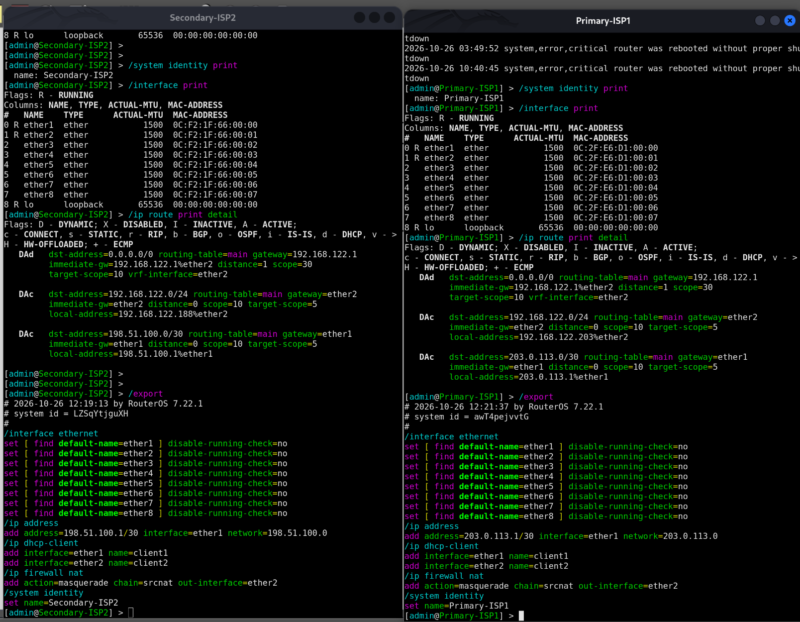
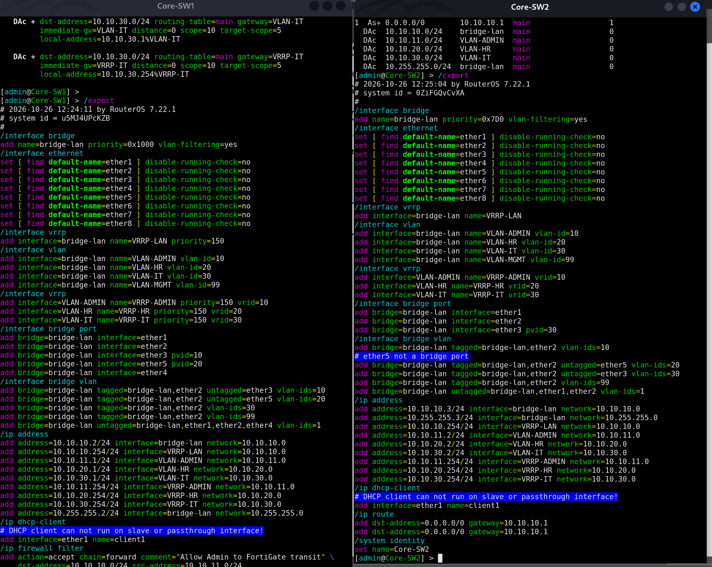
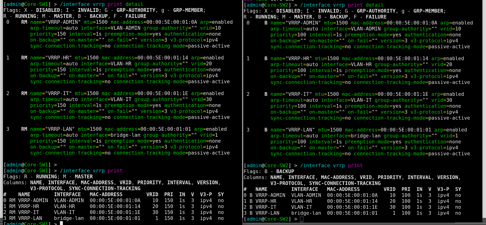
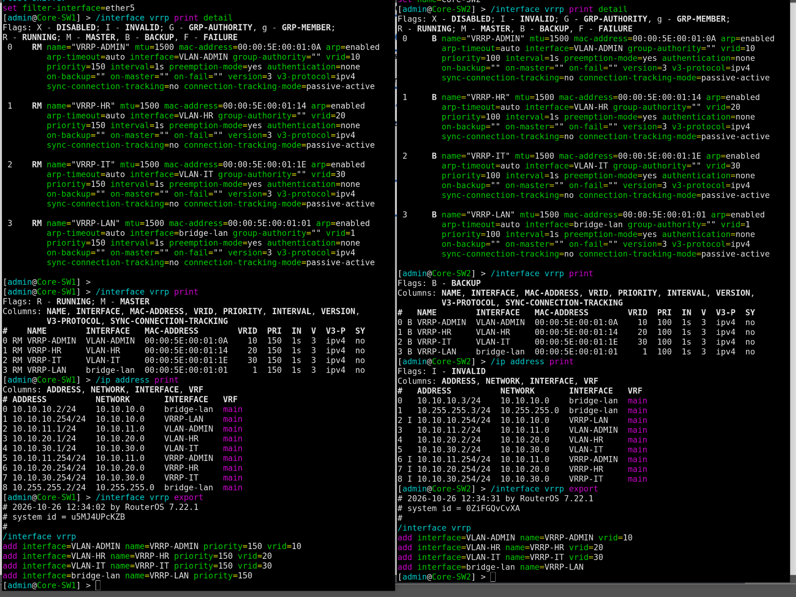
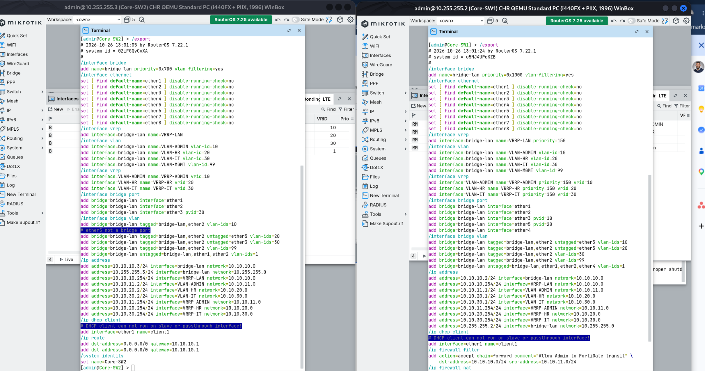

# Enterprise SD-WAN, FortiGate, MikroTik Redundancy and Basic VPN Lab

## Project Overview

This project demonstrates an enterprise network lab built with GNS3, FortiGate, and MikroTik RouterOS. It focuses on dual-ISP connectivity, SD-WAN health monitoring, routing, VLAN segmentation, gateway redundancy, and basic VPN configuration.

The lab simulates a corporate network with separate Admin, HR, and IT departments. The design provides a foundation for testing WAN failover, internal connectivity, and network resilience in a controlled virtual environment.

## Objectives

- Configure FortiGate SD-WAN with primary and secondary ISP links.
- Configure SD-WAN health checks and performance monitoring.
- Simulate ISP connectivity using MikroTik RouterOS.
- Configure VLANs for department separation.
- Implement VRRP for redundant default gateways using two core switches.
- Test client connectivity and observe WAN failover behaviour.
- Document VPN configuration and operational verification.
- Maintain evidence of configuration and testing.

## Lab Topology

The topology contains:

- **JeffLabs-FortiGate:** Firewall, SD-WAN, NAT, and VPN endpoint.
- **Primary-ISP1:** Simulated primary ISP using MikroTik RouterOS.
- **Secondary-ISP2:** Simulated secondary ISP using MikroTik RouterOS.
- **Core-SW1 and Core-SW2:** Core switching, VLAN interfaces, and VRRP.
- **Access-SW1:** Admin department access.
- **Access-SW2:** HR department access.
- **Access-SW3:** IT department access.
- **Department PCs:** Endpoints used for connectivity tests.
- **NAT nodes:** External connectivity for the simulated ISP environment.
- **Cloud-Mgmt:** Management connectivity in the GNS3 topology.

## Technologies Used

| Technology | Purpose |
|---|---|
| GNS3 | Network emulation and topology |
| FortiGate FortiOS | Firewall, SD-WAN, health checks, and VPN |
| MikroTik RouterOS | ISP simulation, routing, and NAT |
| VLANs | Department network segmentation |
| VRRP | Default gateway redundancy |
| VPCS | Client connectivity testing |
| ICMP / ping | Connectivity and failover verification |

## Network Addressing

The following addresses are documented from the lab configuration. Confirm them against the current running configuration before reusing them.

| Component | Address / Network | Purpose |
|---|---|---|
| Primary ISP gateway | `203.0.113.1/30` | Simulated ISP1 |
| FortiGate ISP1 | `203.0.113.2/30` | Primary WAN |
| Secondary ISP gateway | `198.51.100.1/30` | Simulated ISP2 |
| FortiGate ISP2 | `198.51.100.2/30` | Secondary WAN |
| FortiGate core transit | `10.10.10.1/24` | Core connectivity |
| Core-SW1 transit | `10.10.10.2/24` | Core-SW1 management/transit |
| Core-SW2 transit | `10.10.10.3/24` | Core-SW2 management/transit |
| Admin VLAN 10 | `10.10.11.0/24` | Admin department |
| HR VLAN 20 | `10.10.20.0/24` | HR department |
| IT VLAN 30 | `10.10.30.0/24` | IT department |
| Management VLAN 99 | `10.10.99.0/24` | Reserved management network; verify implementation |

The department VRRP virtual gateway is configured as `10.10.x.254` for each department subnet, where applicable.

## FortiGate SD-WAN

The lab uses the SD-WAN zone `virtual-wan-link` with two members:

- **Member 1:** `port1`, gateway `203.0.113.1`.
- **Member 2:** `port2`, gateway `198.51.100.1`.

The SD-WAN configuration includes health checks for the ISP gateways and a rule named `Prefer-ISP1` that prioritises ISP1 over ISP2.

### Verification Commands

Run these commands on FortiGate:

```text
show system sdwan
diagnose sys sdwan member
diagnose sys sdwan health-check
get router info routing-table all
```

Review member state, health-check status, packet loss, latency, jitter, and the active default route.

### Failover Test

1. Start continuous pings from the department PCs to a reachable external test address.
2. Confirm both ISP paths are healthy.
3. Disconnect or disable the primary ISP path in the lab.
4. Observe the health check and default route change.
5. Confirm client connectivity through the secondary path.
6. Restore ISP1 and observe recovery according to the configured SD-WAN rule.

A successful ping test demonstrates reachability at that time. Record the exact route and health-check state when collecting failover evidence.

## MikroTik ISP Routers

The simulated ISP routers use RouterOS and provide gateway addresses for the FortiGate WAN interfaces.

### Useful Commands

```routeros
/system identity print
/interface print
/ip address print
/ip route print detail
/ip firewall nat print
/export
```

Review interface status, connected routes, the default route, and source NAT rules before running failover tests.

## VLANs and Core Redundancy

The core switching design separates department traffic into VLANs:

- VLAN 10 — Admin
- VLAN 20 — HR
- VLAN 30 — IT
- VLAN 99 — Management, subject to verification

Core-SW1 and Core-SW2 are configured with VRRP instances for the department VLANs. The documented configuration uses a higher priority on Core-SW1 than on Core-SW2.

### Verification Commands

```routeros
/interface vlan print
/interface bridge vlan print
/interface bridge port print
/interface vrrp print
/interface vrrp print detail
/ip address print
/ip route print
```

Check VLAN membership, tagged and untagged ports, virtual gateway addresses, and the master/backup state.

**Note:** VRRP redundancy should be tested by taking the active core path out of service and confirming that the backup assumes the master role and clients retain connectivity.

## VPN Configuration

The FortiGate lab contains an IPsec configuration named `Jeff-IPsec`. The captured configuration shows a dial-up FortiClient-oriented phase 1 and a corresponding phase 2 entry.

Useful verification commands include:

```text
show vpn ipsec phase1-interface
show vpn ipsec phase2-interface
diagnose vpn tunnel list
```

The presence of a configured tunnel does not by itself prove successful end-to-end VPN connectivity. Validate authentication, phase negotiation, traffic selectors, routing, and traffic flow before treating the VPN as operational.

**Security:** Do not publish passwords, pre-shared keys, private keys, authentication tokens, or unredacted user credentials.

## Client Connectivity Tests

The Admin, HR, and IT VPCS endpoints have been shown receiving ICMP replies from `8.8.8.8` in the captured evidence.

From a VPCS console, use:

```text
show ip
ping 8.8.8.8
trace 8.8.8.8
```

Verify that each client has the expected address, subnet, and gateway. Repeat connectivity tests during normal operation and during controlled ISP failover.

External ping success alone does not verify every internal service or security policy.

## Evidence and Screenshots

Screenshots are stored under `evidence/captured-2026-10-26/`. Each image should be accompanied by its purpose and the state it demonstrates.

### 1. Network Topology

Shows the GNS3 lab layout, including FortiGate, the two simulated ISPs, both core switches, three access switches, and department PCs. Green link indicators show links that were up at capture time.

### 2. Department PC Connectivity

Shows continuous ICMP replies from `8.8.8.8` on Admin, HR, and IT clients. This is evidence of external reachability at the time of capture.

### 3. MikroTik ISP Router Configuration

Shows the Secondary-ISP2 and Primary-ISP1 RouterOS interfaces, connected networks, default routes, and source NAT configuration.

### 4. Core Switch Configuration

Shows the core switches' bridge, VLAN, IP address, and routing configuration. It also exposes differences in the captured configurations that should be reviewed before treating the two cores as fully symmetrical.

### 5. VRRP Master and Backup State

Shows Core-SW1 as VRRP master and Core-SW2 as backup for the captured VRRP instances. This documents the observed state; a separate controlled outage test is required to demonstrate successful role transition.

### 6. FortiGate SD-WAN Configuration

Shows SD-WAN members using `port1` and `port2`, their configured gateways, health checks, and the `Prefer-ISP1` rule.

### 7. FortiGate SD-WAN Member Diagnostics

Shows the diagnostic output for the two SD-WAN members, including their configured gateways and interface details.

### 8. FortiGate Health-Check Diagnostics

Shows both ISP health checks reporting an alive state with packet loss, latency, and jitter metrics at capture time.

### 9. IPsec Phase 1 Configuration

Shows the `Jeff-IPsec` phase 1 configuration, including the interface, dial-up mode, and client address pool settings. Sensitive values must be reviewed before public release.

### 10. IPsec Phase 2 Configuration

Shows the phase 2 entry linked to the `Jeff-IPsec` phase 1 configuration. This demonstrates configuration presence, not a successful negotiated VPN session.

### 11. IPsec Tunnel Diagnostics

Shows the output of `diagnose vpn tunnel list`, including the tunnel state and traffic counters at capture time. Review the counters and peer state when verifying actual VPN traffic.

### 12. MikroTik Core Configuration in WinBox

Shows the core switch RouterOS exports and configuration windows in WinBox, including VLAN interfaces, VRRP, bridge VLAN settings, and routes.

### 13. FortiGate SD-WAN Performance SLA Dashboard

Shows the FortiGate SD-WAN Performance SLA view, including latency, packet loss, jitter, and the observed health-check state for the ISP links.

### 14. Additional Configuration Evidence

Any further captured configuration screenshots should be labelled with the device name, command or feature shown, and the test state. Do not infer success from configuration output alone.

## Current Limitations and Validation Notes

- This is a virtual lab, not a production deployment.
- The simulated ISP networks use documentation address ranges.
- Some captured screenshots show different configuration snapshots. Verify them against the current running configuration before reproducing the lab.
- Health checks showing both links alive demonstrate monitoring at that moment; they are not by themselves proof of failover.
- VRRP master/backup status demonstrates election state; successful failover requires a separate test.
- VPN configuration output does not alone prove end-to-end VPN operation.
- Any unresolved routing, reverse-path, or internal management connectivity issue should be documented rather than presented as fixed.

## Repository Structure

```text
Enterprise_SD-WAN-FortiGate-_MikroTik_Redundancy-Basic-VPN/
├── README.md
├── configs/
│   ├── fortigate/
│   ├── mikrotik/
│   └── vpcs/
├── docs/
└── evidence/
    └── captured-2026-10-26/
```

## Future Enhancements

- Add a dedicated Agents VLAN with restricted access to approved internal applications.
- Validate and document complete ISP1-to-ISP2 and ISP2-to-ISP1 failover.
- Test VRRP failover by shutting down the active core path.
- Complete end-to-end IPsec VPN testing.
- Add sanitised configuration exports and test results.
- Improve management-plane isolation and inter-VLAN firewall policies.

## Disclaimer

This project is intended for educational and portfolio demonstration purposes. Validate configurations and security policies before applying them to a real network.


## Evidence Gallery

The following screenshots document the current state of the SD-WAN lab. They provide visual evidence of the topology, routing, VLANs, redundancy, SD-WAN monitoring, and IPsec VPN configuration. A screenshot records the state at the time of capture; it does not automatically prove end-to-end functionality.

### 1. GNS3 Network Topology


The lab topology shows the FortiGate firewall, simulated ISP connections, MikroTik core switches, access switches, and departmental PCs.

### 2. Department PC Internet Connectivity


Shows connectivity testing from departmental PCs. Use the captured results to identify which endpoints responded during the test.

### 3. ISP Router Interfaces and Routes



Documents ISP router interface addressing and route information used to support the simulated WAN paths.

### 4. Core Switch VLAN and Bridge Configuration



Shows the VLAN and bridge configuration used to separate departmental network traffic.

### 5. Core Switch VRRP Master and Backup



Records the VRRP roles reported by the two core switches at capture time. A separate outage test is required to confirm successful gateway failover.

### 6. Core Switch VRRP and Address Details



Documents VRRP settings and address information used for redundant default-gateway configuration.

### 7. FortiGate SD-WAN Health Checks


Shows the configured SD-WAN health checks used to monitor WAN link reachability.

### 8. FortiGate SD-WAN Members and Gateways


Documents the WAN interfaces and gateways associated with the SD-WAN configuration.

### 9. FortiGate SD-WAN Member Diagnostics


Shows diagnostic information for SD-WAN members. Confirm the interface and route state before interpreting the output as proof of failover.

### 10. IPsec VPN Phase 1


Documents the Phase 1 settings for the IPsec VPN peer negotiation.

### 11. IPsec VPN Phase 2


Shows Phase 2 settings, which define the protected traffic selectors and IPsec parameters.

### 12. IPsec Tunnel Status


Records the reported IPsec tunnel status at capture time. End-to-end traffic testing is still needed to establish that the VPN carries the intended traffic.

### 13. WinBox Core Switch Exports



Provides WinBox-based configuration evidence for the core switches.

### 14. FortiGate SD-WAN Performance SLAs


Documents the configured SD-WAN performance service-level agreements used to assess WAN link quality.

