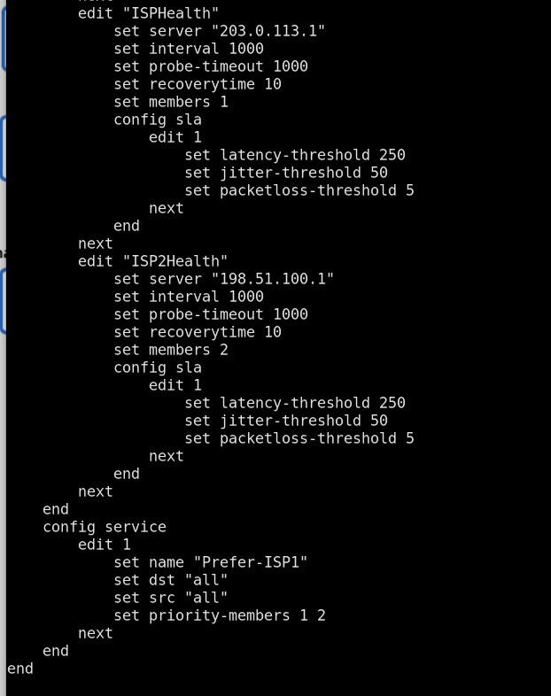
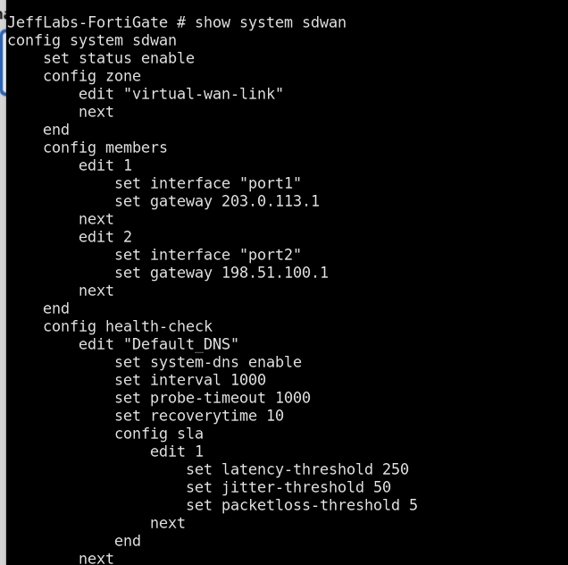
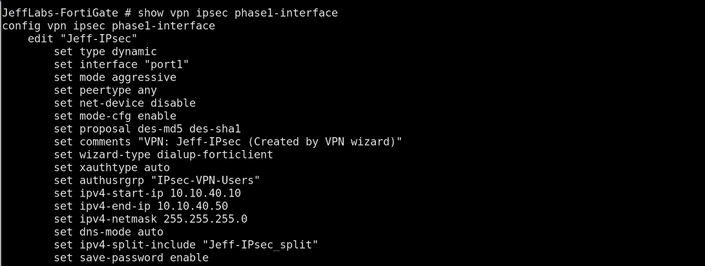
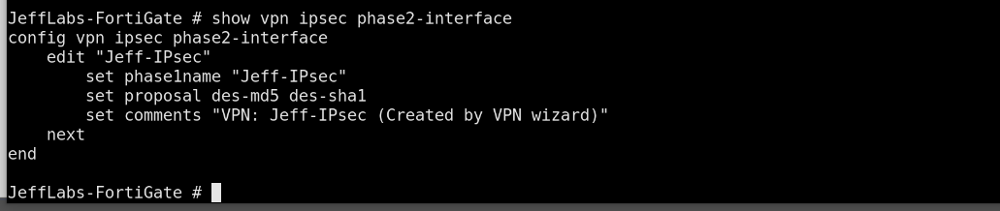
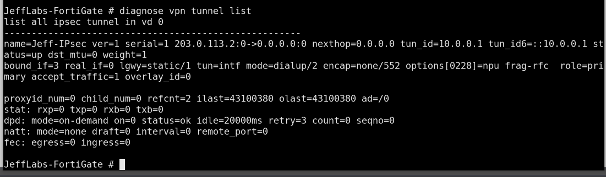
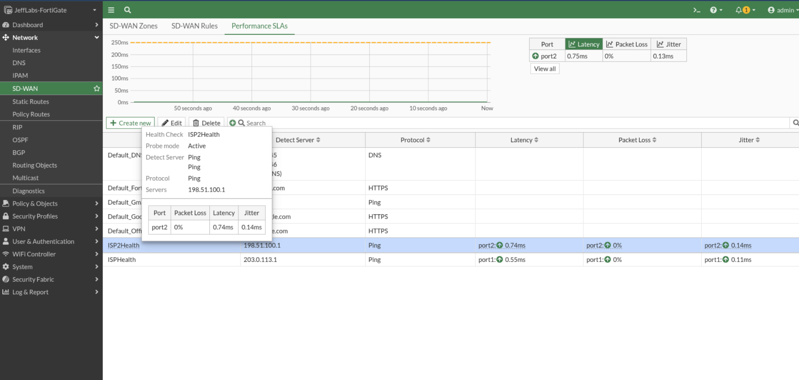

# FortiGate SD-WAN and Firewall Configuration

## Overview

The FortiGate firewall connects to two simulated ISP routers and the core switching network. SD-WAN monitors both WAN links and applies a preferred path for outbound traffic.

## Interface Addressing

| Interface | Role | Address |
|---|---|---|
| port1 | Primary ISP | 203.0.113.2/30 |
| port2 | Secondary ISP | 198.51.100.2/30 |
| port3 | Core transit | 10.10.10.1/24 |

Verify these values against the current FortiGate configuration before applying any commands.

## SD-WAN Members

| Member | Interface | Gateway |
|---|---|---|
| 1 | port1 | 203.0.113.1 |
| 2 | port2 | 198.51.100.1 |

The SD-WAN zone is `virtual-wan-link`. The configured rule `Prefer-ISP1` gives preference to member 1, with member 2 as the secondary choice.

## Health Checks

The lab includes health checks for both ISP gateways:

- `ISPHealth` monitors `203.0.113.1`.
- `ISP2Health` monitors `198.51.100.1`.

The captured configuration uses 1-second intervals and SLA thresholds for latency, jitter, and packet loss. Actual link selection depends on the active SD-WAN configuration and health-check state.

## Verification Commands

Run these commands in the FortiGate CLI:

```text
show system interface
show system sdwan
diagnose sys sdwan member
diagnose sys sdwan health-check
get router info routing-table all
show firewall policy
show firewall central-snat-map
```

Some commands may return no entries if the corresponding feature is not configured.

## Failover Procedure

1. Confirm both ISP links are up and health checks are passing.
2. Start continuous pings from the department PCs to a reachable external address.
3. Disable the primary ISP link in the lab.
4. Check the SD-WAN health-check output and routing table.
5. Verify that traffic uses the secondary ISP.
6. Restore the primary ISP and observe recovery.

Record the exact output and any packet loss during each test.

## Firewall and NAT

The intended outbound path is from the core transit interface to the SD-WAN zone, with source NAT enabled on the applicable firewall policy.

Review the current firewall policies before making changes. A configured policy does not prove that all department traffic is permitted or that internal routing is correct.

## Troubleshooting Notes

If a client cannot reach an internal or external destination, verify:

- The client's IP address and default gateway.
- VLAN and VRRP status on both core switches.
- The route to the client subnet on FortiGate.
- The SD-WAN member state and selected default route.
- Firewall policy order and NAT settings.
- Reverse-path check messages and routing symmetry.

Do not disable security checks merely to hide a routing problem. Identify and correct the routing or interface configuration first.

## Security

Never commit passwords, VPN pre-shared keys, private keys, access tokens, or unredacted credentials to a public repository.


## Screenshot Evidence

### SD-WAN Health Checks



Shows the configured health checks used to monitor WAN reachability.

### SD-WAN Members and Gateways



Documents the WAN members and associated gateways.

### SD-WAN Member Diagnostics


Provides a diagnostic snapshot of SD-WAN member state. Confirm routing and traffic flow separately before claiming successful failover.

### IPsec Phase 1



Documents the Phase 1 VPN peer negotiation settings.

### IPsec Phase 2



Documents the Phase 2 parameters and protected traffic selectors.

### IPsec Tunnel Status



Records the reported tunnel state at capture time. End-to-end traffic testing is required to validate VPN operation.

### SD-WAN Performance SLAs



Shows the configured performance SLAs used to assess WAN link quality.
