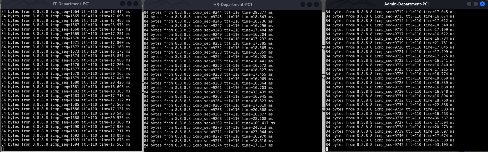

# VPCS Department Connectivity Tests

## Overview

Virtual PCs represent users in the Admin, HR, and IT departments. They are used to verify addressing, default gateways, and external reachability through the FortiGate SD-WAN environment.

## Documented Client Addresses

| Department | VLAN | Client Address | Expected Gateway |
|---|---:|---|---|
| Admin | 10 | `10.10.11.10/24` | `10.10.11.254` |
| HR | 20 | `10.10.20.10/24` | `10.10.20.254` |
| IT | 30 | `10.10.30.10/24` | `10.10.30.254` |

Verify these values against each running VPCS instance before testing.

## VPCS Commands

On each VPCS console:

```text
show ip
ping 10.10.11.254
ping 10.10.20.254
ping 10.10.30.254
ping 8.8.8.8
trace 8.8.8.8
```

Test only the gateways and destinations that should be reachable under the intended security policy. Cross-department pings may correctly fail if inter-VLAN traffic is restricted.

## External Connectivity Test

1. Confirm the client address, subnet mask, and default gateway.
2. Ping the local VRRP gateway.
3. Ping a reachable external test address.
4. Record packet loss and response times.
5. Repeat while the primary ISP path is unavailable.
6. Confirm that connectivity recovers through the secondary ISP.

The captured evidence shows Admin, HR, and IT clients receiving replies from `8.8.8.8` at the time of capture.

## Interpreting Results

- **Gateway ping succeeds:** The client can reach its local gateway.
- **External ping succeeds:** The tested external address is reachable at that time.
- **Gateway ping fails:** Check the client address, VLAN assignment, access/trunk links, and VRRP state.
- **Gateway succeeds but external ping fails:** Check routing, SD-WAN health, firewall policies, NAT, and return paths.
- **Connectivity drops during failover:** Record the duration and packet loss, then inspect health-check and routing changes.

A successful ping is useful evidence but does not prove that every application, route, or security policy is working.

## Test Record

For repeatable results, record:

- Date and time.
- Client and source IP.
- Destination IP.
- Primary and secondary ISP health states.
- Active FortiGate route.
- Packet loss and response time.
- Result during normal operation and failover.


## Screenshot Evidence

### Department PC Connectivity



Shows connectivity test results from the departmental PCs. Use the actual replies and failures shown in the capture when documenting test outcomes.
