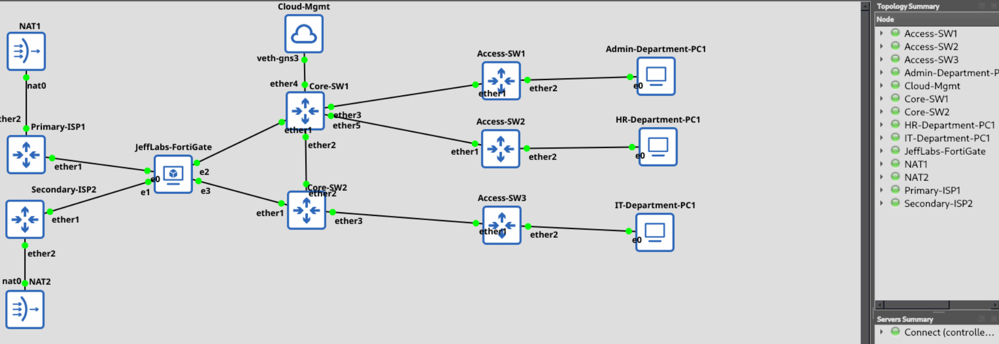
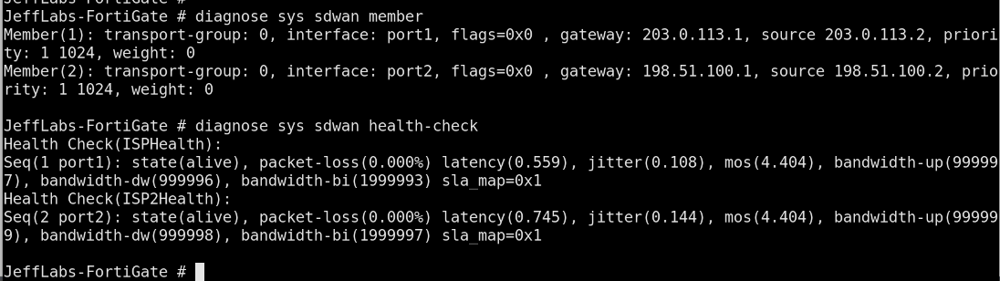

# Network Lab Verification Guide

## Purpose

This guide provides repeatable checks for the Enterprise SD-WAN, FortiGate, MikroTik, VLAN, VRRP, and VPN lab.

## 1. Verify FortiGate SD-WAN

Run:

```text
diagnose sys sdwan member
diagnose sys sdwan health-check
get router info routing-table all
```

Confirm that both WAN members are present, review their health-check state, and identify the active default route.

## 2. Verify MikroTik ISP Routers

Run on each ISP router:

```routeros
/interface print
/ip address print
/ip route print detail
/ip firewall nat print
```

Confirm the WAN-facing gateway addresses, upstream route, and intended NAT configuration.

## 3. Verify Core Switching and VRRP

Run on both core switches:

```routeros
/interface bridge vlan print
/interface vlan print
/ip address print
/ip route print detail
/interface vrrp print detail
```

Confirm VLAN membership, routing, virtual gateway addresses, and the current VRRP master/backup roles.

## 4. Verify Client Connectivity

On each VPCS client:

```text
show ip
ping <expected-gateway>
ping 8.8.8.8
trace 8.8.8.8
```

Replace `<expected-gateway>` with the client's actual virtual gateway.

## 5. Test ISP Failover

1. Establish baseline client connectivity.
2. Record both ISP health-check states and the default route.
3. Disconnect the primary ISP link in the lab.
4. Observe the SD-WAN health-check and route changes.
5. Check client connectivity through the secondary ISP.
6. Restore the primary link and record recovery.

Repeat the procedure in reverse if testing secondary ISP failure.

## 6. Test VRRP Failover

1. Confirm the current master and backup.
2. Start a continuous ping to the virtual gateway.
3. Disable the active core path in the lab.
4. Confirm the backup takes over.
5. Verify that the client retains gateway connectivity.
6. Restore the original path and document the result.

## 7. Verify IPsec VPN

Run:

```text
diagnose vpn tunnel list
```

Review the tunnel state and traffic counters. Confirm successful negotiation and test traffic between the intended endpoints before marking the VPN as operational.

## Evidence Requirements

For each test, record:

- Date and time.
- Device and interface.
- Command or action performed.
- Expected result.
- Actual result.
- Screenshot or sanitized command output.
- Any outstanding issue.

Do not report a test as successful unless the observed result supports that conclusion.


## Screenshot Evidence

### Overall Lab Topology



Use this topology as a reference when performing the verification steps above. Confirm device names, links, and interface assignments against the current lab.

### SD-WAN Diagnostics



Use this capture as a historical diagnostic reference. Verify the current route table, health-check results, and end-to-end traffic when testing failover.
